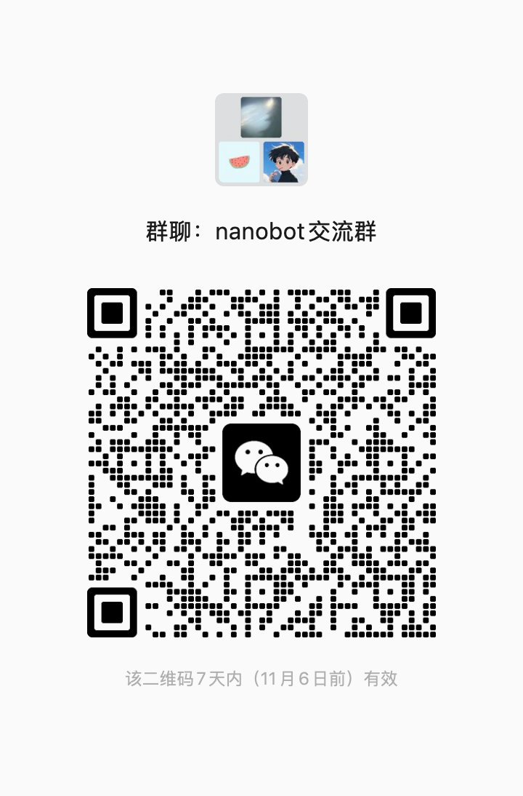

# Community

## WeChat

**nanobot 微信交流群** · 交流使用心得、分享作品、讨论开发。

用微信扫描下方二维码加入。手机上可点击图片查看原图，保存后在微信「扫一扫」中从相册选择。

Scan with WeChat to join the Chinese-speaking nanobot community. Tap the image for the full-size version.

**有效期：2026 年 11 月 6 日前。** 群码失效或群已满时，请在[社区欢迎帖](https://github.com/HKUDS/nanobot/discussions/50)留言。

**Valid before November 6, 2026.** If the code expires or the group is full, leave a comment in our [welcome discussion](https://github.com/HKUDS/nanobot/discussions/50).

## HKUDS community

The broader HKUDS discussion groups are available on **WeChat** and **Feishu**.

You can join by scanning the QR codes below:

