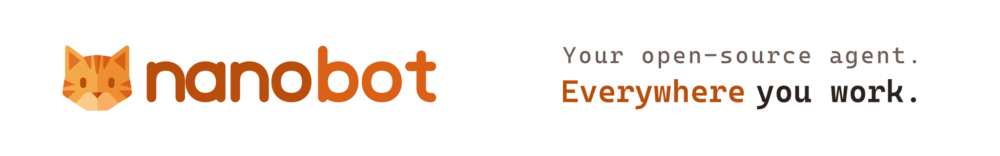
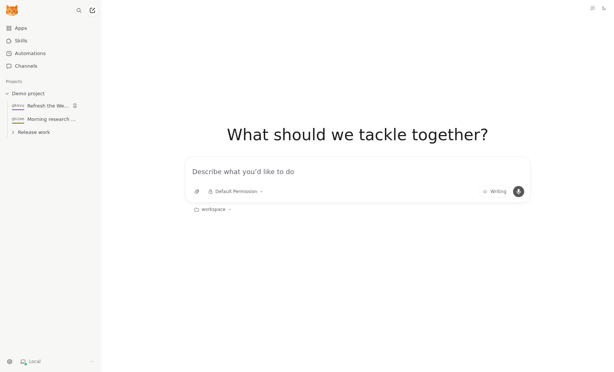
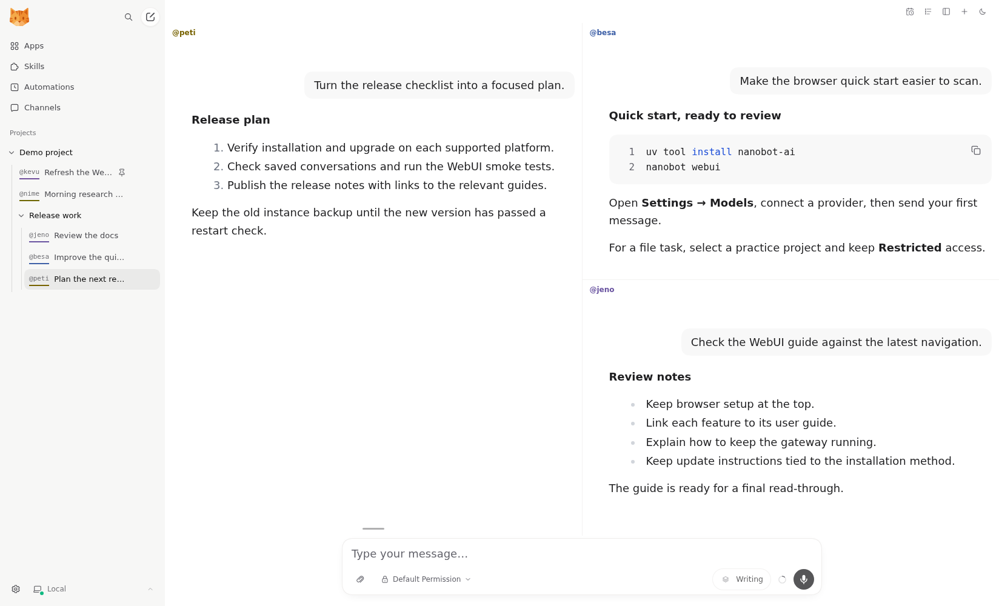
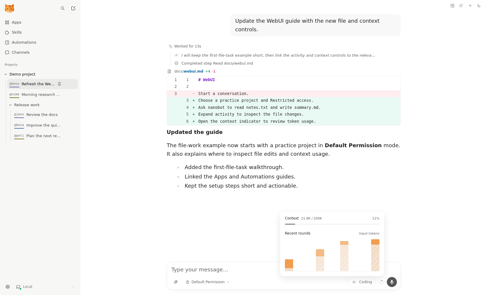
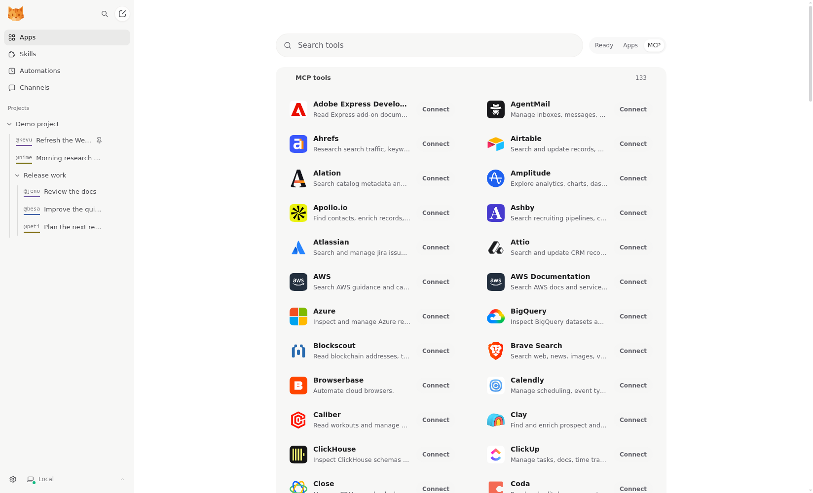
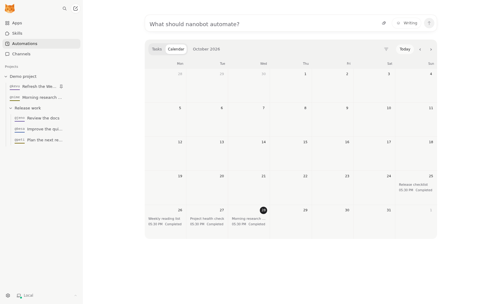
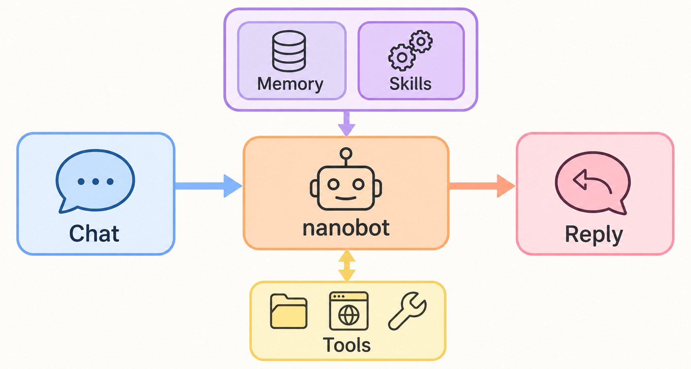

<picture>
  <source media="(prefers-color-scheme: dark)" srcset="./images/readme-cover-dark.svg">
  
</picture>

<div align="center">
  <p>
    <a href="https://nanobot.wiki/docs/latest/getting-started/nanobot-overview">English</a> |
    <a href="https://nanobot.wiki/cn/docs/latest/getting-started/nanobot-overview">简体中文</a> |
    <a href="https://nanobot.wiki/zh-Hant/docs/latest/getting-started/nanobot-overview">繁體中文</a> |
    <a href="https://nanobot.wiki/es/docs/latest/getting-started/nanobot-overview">Español</a> |
    <a href="https://nanobot.wiki/fr/docs/latest/getting-started/nanobot-overview">Français</a> |
    <a href="https://nanobot.wiki/id/docs/latest/getting-started/nanobot-overview">Bahasa Indonesia</a> |
    <a href="https://nanobot.wiki/ja/docs/latest/getting-started/nanobot-overview">日本語</a> |
    <a href="https://nanobot.wiki/ko/docs/latest/getting-started/nanobot-overview">한국어</a> |
    <a href="https://nanobot.wiki/ru/docs/latest/getting-started/nanobot-overview">Русский</a> |
    <a href="https://nanobot.wiki/vi/docs/latest/getting-started/nanobot-overview">Tiếng Việt</a>
  </p>
  <p>
    <a href="https://github.com/HKUDS/nanobot"></a>
    <a href="https://pypi.org/project/nanobot-ai/"></a>
    <a href="https://pepy.tech/project/nanobot-ai"></a>
    <a href="https://github.com/HKUDS/nanobot/actions/workflows/ci.yml"></a>
    <a href="https://pypi.org/project/nanobot-ai/"></a>
    <a href="./LICENSE"></a>
    <a href="https://nanobot.wiki/docs/latest/getting-started/nanobot-overview"></a>
  </p>
  <p>
    <a href="https://discord.gg/MnCvHqpUGB">Discord</a> ·
    <a href="https://x.com/nanobot_project">X</a> ·
    <a href="./COMMUNICATION.md">WeChat / Feishu</a>
  </p>
</div>

# nanobot

🐈 **nanobot** is an ultra-lightweight, open-source, self-hosted personal AI agent framework written in Python. Use it in a browser, terminal, or chat app to work with files, remember preferences, and schedule tasks. Connect a supported model provider or local model server to supply the AI.

## Start Here

| You want to... | Go to |
|---|---|
| Install nanobot with no terminal/config background | [Start Without Technical Background](./docs/start-without-technical-background.md) |
| Install quickly and get your first reply | [Install](#-install) and [Quick Start](#-quick-start) |
| Open the bundled browser UI | [WebUI](#-webui) |
| Connect Telegram, Discord, WeChat, Slack, Email, Mattermost, Linear, or another channel | [Chat app guide](./docs/guides/chat-app-ai-agent.md) |
| Configure providers, fallback models, Langfuse, MCP, web tools, or security | [Docs](./docs/README.md) and [Configuration](./docs/configuration.md) |
| Develop the browser UI | [Install current source](#-install), then [WebUI development](./webui/README.md) and [Contributing](./CONTRIBUTING.md) |
| Integrate from Python or HTTP | [Python SDK](./docs/python-sdk.md) or [Agent API](./docs/openai-api.md) |
| Understand or extend the internals | [Architecture](./docs/architecture.md), [Contributing](./CONTRIBUTING.md), and [Provider extensions](./docs/development.md) |
| Deploy to the cloud or keep nanobot running as a service | [Deployment](./docs/deployment.md) |

## What can nanobot do?

nanobot can:

- run in a browser WebUI or terminal
- connect to Telegram, Discord, Slack, WeChat, Email, Mattermost, Linear, and other channels
- read PDF, Word (`.docx`), Excel (`.xlsx`), and PowerPoint (`.pptx`) files with built-in file tools, for tasks such as summarizing reports
- use shell, web search/fetch, MCP integrations, cron, image generation, and multi-agent delegation
- keep session history and long-term memory through [Dream](./docs/memory.md#save-and-check-a-preference)
- run [long-horizon goals](./docs/guides/long-running-ai-agent.md) and [scheduled automations](./docs/automations.md)
- expose a Python SDK and OpenAI-compatible API for integrations
- deploy as a long-running local or server-side agent gateway

## 💡 Why nanobot

- **Persistent workflows**: keep saved conversations, long-term memory, and task results for later work.
- **Chat-native reach**: WebUI, API, Telegram, Feishu, Slack, Discord, Teams, email, Mattermost, and Linear.
- **Model freedom**: OpenAI-compatible APIs, local LLMs, image generation, search, and fallbacks.
- **Small core**: readable internals with MCP, memory, deployment, and automation built in.
- **Own your stack**: inspect, customize, self-host, and extend without a giant platform.

## 📦 Install

You need **Python 3.11 or newer** and access to a [supported model provider or local model server](./docs/providers.md). Model fees or local hardware requirements depend on the service you choose; nanobot does not supply a model account.

Choose the **stable release** for everyday use or **current source** for development and the latest features. This README describes current source; [published documentation](https://nanobot.wiki/docs/latest/getting-started/nanobot-overview) covers the released version.

New to terminals or model credentials? Follow [Start Without Technical Background](./docs/start-without-technical-background.md). Updating an existing instance? Back up its config directory and workspace, stop every old nanobot process using that workspace, then update and restart through the original launcher or service. See [session storage and version changes](./docs/cli-reference.md#session-storage-and-rollback).

**Stable release: automatic setup (recommended)**

The installer chooses an isolated Python environment and opens setup for you. The two commands below are the same installation method for different operating systems; run only the one for your system.

<details>
<summary>macOS / Linux</summary>

```bash
curl -fsSL https://raw.githubusercontent.com/HKUDS/nanobot/main/scripts/install.sh | sh
```

</details>

<details>
<summary>Windows PowerShell</summary>

```powershell
irm https://raw.githubusercontent.com/HKUDS/nanobot/main/scripts/install.ps1 | iex
```

</details>

<details>
<summary>Installer details, preview, and script review</summary>

The installer installs or upgrades `nanobot-ai` using an active virtual environment, `uv`, `pipx`, or a managed venv under `~/.nanobot/venv`. Fresh local desktops open the WebUI; SSH, headless, existing-config, and older-release paths use the terminal setup wizard. Keep the printed command: it identifies the environment that owns the installation.

To preview the plan without changing your environment, pass `--dry-run`.

```bash
curl -fsSL https://raw.githubusercontent.com/HKUDS/nanobot/main/scripts/install.sh | sh -s -- --dry-run
```

```powershell
& ([scriptblock]::Create((irm https://raw.githubusercontent.com/HKUDS/nanobot/main/scripts/install.ps1))) --dry-run
```

If you prefer to inspect the script first, open [`scripts/install.sh`](./scripts/install.sh) or [`scripts/install.ps1`](./scripts/install.ps1).

</details>

<details>
<summary>Already use uv or pip? Install the stable package yourself</summary>

Use this instead of the recommended installer when you already manage your own Python environment. These commands install the same stable `nanobot-ai` package; they do not launch setup.

**uv: isolated CLI installation**

```bash
uv tool install nanobot-ai
```

**pip: activate your virtual environment first**

```bash
python -m pip install nanobot-ai
```

Then run `nanobot webui` for browser setup, or `nanobot onboard --wizard` for terminal-only setup. For the [Python SDK](./docs/python-sdk.md), install `nanobot-ai` in your application's virtual environment so the application can import it; a separate `uv tool` environment does not make the SDK importable there.

If pip reports `externally-managed-environment`, use the recommended installer, `uv tool install nanobot-ai`, `pipx install nanobot-ai`, or an activated virtual environment. Upgrade with the same method; for uv use `uv tool upgrade nanobot-ai`, and for pip use `python -m pip install -U nanobot-ai`.

</details>

**Current source: development checkout**

<details>
<summary>Install current source with Git and Bun</summary>

Clone the repository and install it in editable mode. A source install requires Git and [Bun](https://bun.sh/); Bun runs the matching TUI directly from the checkout instead of downloading an older release binary.

```bash
git clone https://github.com/HKUDS/nanobot.git
cd nanobot
python -m venv .venv
```

Activate it with `source .venv/bin/activate` on macOS/Linux or `.venv\Scripts\Activate.ps1` in Windows PowerShell, then run:

```bash
python -m pip install -e .
```

After that, the normal commands are identical to a stable install. `nanobot` runs the TUI from this checkout, and `nanobot webui` rebuilds stale frontend assets automatically. After stopping the old instance, `git pull --ff-only` updates the Python, TUI, and WebUI source together; rerun `python -m pip install -e .` when Python dependencies change, then restart the instance. Contributors should also read [`CONTRIBUTING.md`](./CONTRIBUTING.md).

</details>

<details>
<summary>Supported platforms, bundled UIs, and release tracks</summary>

Published packages include the WebUI, and supported platform wheels also include the native TUI. A source-distribution install can fetch a checksummed, version-matched TUI archive—with its licenses, notices, corresponding application source, source offer, and relinking instructions—on first use.

Platform wheels include both the WebUI and the native terminal UI: macOS 13+ (Apple Silicon and Intel), glibc 2.17+ Linux (ARM64 and x64), and Windows x64. The x64 runtime requires SSE4.2. Pip selects the matching wheel; opening the TUI does not need a separate GitHub download or Bun installation. A source-distribution install on a supported target can use the matching checksummed GitHub release archive. On other platforms, use `nanobot --classic` or the WebUI.

> [!IMPORTANT]
>
> If you want the newest features and experiments, install from source.
>
> If you want the most stable day-to-day experience, install from PyPI or with `uv`.

Pick **one** install method:

| Track | Install with | Update with | What runs |
|---|---|---|---|
| Stable | installer, `uv`, or pip | [same installation method](./docs/quick-start.md#updating) | one released Python/WebUI/TUI version |
| Current source | editable Git checkout | `git pull --ff-only` + editable dependency sync | Python, WebUI, and TUI from that checkout |

</details>

<details>
<summary>Verify the installation or locate the nanobot command</summary>

Verify the install:

```bash
nanobot --version
```

If `nanobot` is not on `PATH`, invoke it through the method that installed it: reuse the recommended installer's command, use `uv tool run --from nanobot-ai nanobot ...` or `pipx run --spec nanobot-ai nanobot ...`, or use the Python executable from the environment where pip installed the package.

</details>

After installation, continue with [Quick Start](#-quick-start). Use the exact command printed by the installer if `nanobot` is not on `PATH`.

## 🚀 Quick Start

**Open nanobot in your browser**

If the installer already opened the WebUI, continue there. Otherwise run:

```bash
nanobot webui
```

Keep the launcher terminal open while using the browser. It starts or joins the shared local gateway and binds the first-run WebUI to localhost. If the browser does not open, copy the complete login link printed in the terminal, including everything after `#`; keep this credential private. For SSH or a headless host, use the remote-browser or terminal-only instructions below.

**Your first three steps**

1. Open **Settings → Models** and save a provider/model preset with your credential or supported sign-in. See [model setup](./docs/quick-start.md#2-configure-your-model) if you need the full steps.
2. Start a new topic and send `Hello!` to verify the model connection.
3. To try file work, put a copy of `notes.txt` in a practice folder, select that folder and **Restricted** access, and ask: "Read notes.txt and write a short summary to summary.md." Open `summary.md` in that folder to check the result. See [Your first file task](./docs/start-without-technical-background.md#your-first-file-task).

A normal reply verifies the provider/model and browser connection. The file task separately checks the selected project and its file permissions. Attaching a file sends it to the conversation; it does not change the selected project folder.

Then describe your next goal in the same chat, for example: "I am already using the WebUI. Help me connect Telegram and allow only my account." An enabled `nanobot-document` skill can consult the documentation bundled with your installation; see [Continue with nanobot](./docs/quick-start.md#continue-with-nanobot) for examples, explicit invocation, and availability.

<details>
<summary>Open the WebUI on a remote server through SSH</summary>

After installing nanobot on the server, start its WebUI without opening a server-side browser:

```bash
nanobot webui --no-open
```

Keep that server terminal running. In a second terminal on your own computer, forward the default WebUI port through SSH:

```bash
ssh -N -L 127.0.0.1:8765:127.0.0.1:8765 user@SERVER
```

Replace `user@SERVER` with your SSH login and leave the tunnel open. In your local browser, open the complete login link printed by the server launcher, preserving its `#` fragment. It uses `http://127.0.0.1:8765`, which now reaches the server through the tunnel. Complete **Settings → Models** and send `Hello!`. If local port `8765` is occupied, use another local port in the tunnel and change only the port in the browser link. Keep the server listener on localhost. For Docker, public endpoints, or service management, see [Deployment](./docs/deployment.md).

</details>

<details>
<summary>Terminal-only setup, one-shot checks, and the TUI</summary>

If a model is not configured yet, use the terminal wizard:

```bash
nanobot onboard --wizard
```

Check one reply without opening the browser:

```bash
nanobot -m "Hello!"
```

For interactive work, open the terminal client:

```bash
nanobot
```

The native TUI uses the launch directory as its project workspace and shares saved conversations and the local gateway with the WebUI. The explicit `nanobot agent` form remains available for compatibility.

- Type `/` to discover commands, `/sessions` to switch conversations, or `@` to mention an app, MCP server, or saved session.
- Paste clipboard images with `Ctrl+V` or `Alt+V`, and use `$` to complete skill references.
- Use `/diff` to inspect file changes, `/context` to inspect session context, or `/branch` to continue from a completed reply in a new session.
- Press `Enter` to send. While nanobot is working, `Enter` sends now and `Tab` sends after the current response. Press `Shift+Enter` to add a newline (`Ctrl+J` works in terminals that cannot distinguish modified Enter keys).
- Use `/detach` to promote the gateway to background mode and close the TUI while work continues.

Each launch starts a new session by default. Use `--session` to resume one and `--workspace` to choose another project workspace. See the [CLI reference](./docs/cli-reference.md#agent-cli) for session branching, diffs, history, shortcuts, gateway lifecycle, and compatibility options.

</details>

<details>
<summary>Save and check a preference</summary>

State a specific preference in your chat, for example: "For release notes, use concise bullet points." To consolidate it now, send `/compact` and then `/dream`, waiting for each to finish, and review `/dream-log`. Check the actual changes to `USER.md` or `memory/MEMORY.md` in the configured agent workspace, then test reuse in a new topic in the same instance. Dream may decide that no durable change is needed; a conversational acknowledgement alone does not prove the preference was saved. See [Save and Check a Preference](./docs/memory.md#save-and-check-a-preference) for file access, correction, and restoration steps.

</details>

<details>
<summary>Start and stop a sustained goal</summary>

Use a regular topic for a bounded objective with a clear completion condition, for example:

```text
/goal Review this project's tests and list the smallest missing test case.
```

The goal lets nanobot continue work across model turns while the gateway runs; a scheduled automation instead starts a turn at specified times. Use `/stop` to interrupt the current work, and ask nanobot to cancel the goal if you want to abandon it. Keep the gateway running for unattended work using the background or service options below.

After a gateway restart, reopen the original topic and review saved results before explicitly continuing any interrupted work. Recovery does not blindly replay uncertain tool actions. See the [long-running agent guide](./docs/guides/long-running-ai-agent.md) for starting conditions and related automation options.

</details>

<details>
<summary>Keep the gateway running after closing interactive clients</summary>

After model setup, keep channels and automations running when interactive launchers close:

```bash
nanobot gateway --background
```

This starts or promotes the shared gateway to a detached process. From the TUI, `/detach` does the same before closing that client. Background mode does not configure startup after a machine reboot or restart after a crash; use an [OS-managed service](./docs/deployment.md#switch-an-existing-gateway-to-a-service) for that. Interrupted subagent tasks are not automatically relaunched after a restart, and missed scheduled times are not replayed; see [subagent recovery](./docs/concepts.md#subagents) and [automation delivery](./docs/automations.md#delivery-and-reliability).

Manage the background gateway with:

```bash
nanobot gateway status
nanobot gateway logs
nanobot gateway restart
nanobot gateway stop
```

To reopen the browser, run `nanobot webui` against the same instance and use its complete printed login link.

</details>

<details>
<summary>Run a configured gateway directly</summary>

Use this once a model is configured and you want to run the gateway directly in the current terminal:

```bash
nanobot gateway
```

It skips guided WebUI setup and browser opening. The WebUI remains available when its channel is configured. Use `nanobot gateway --background` for a detached process, or follow [Deployment](./docs/deployment.md) for startup and supervision by the operating system.

</details>

<details>
<summary>Read task guides or look up configuration details</summary>

- Model/provider recipes: [Provider Cookbook](./docs/provider-cookbook.md) and [Providers and Models](./docs/providers.md).
- Local models: [Ollama](./docs/providers.md#ollama), [vLLM or another OpenAI-compatible server](./docs/providers.md#vllm-or-other-local-openai-compatible-server).
- Chat platforms: [Chat app guide](./docs/guides/chat-app-ai-agent.md), then the [full channel reference](./docs/chat-apps.md).
- Exact settings for web search, MCP, voice, image generation, and security: [Configuration](./docs/configuration.md).
- Manual JSON and other setup paths: [Install and Quick Start](./docs/quick-start.md).
- Failures after setup: [Troubleshooting](./docs/troubleshooting.md).

</details>

If nanobot worked for you, a star on GitHub is the simplest way to support the project.

<a id="deploy-to-render"></a>

## ☁️ Deploy

**Render — one click**

Deploy nanobot's gateway and bundled WebUI from the repository's ready-to-use Blueprint:

[](https://render.com/deploy?repo=https://github.com/HKUDS/nanobot)

Render will ask for `ANTHROPIC_API_KEY` and a private `NANOBOT_WEB_TOKEN`, then provision persistent storage for sessions, memory, and WebUI history. Persistent disks require a paid Render service.

**Self-host**

Prefer your own infrastructure? Follow the [deployment guide](./docs/deployment.md) for Docker, Docker Compose, Linux services, and macOS LaunchAgent setup.

## 🌐 WebUI

The WebUI ships **inside the published wheel** with no separate frontend build. It is the browser workbench for persistent topics, temporary chats, visible agent activity, workspace controls, Apps, Skills, Automations, and settings. Start it with `nanobot webui`. WebUI access grants administration of the same agent instance; share it only with trusted operators. See [Sharing access](./docs/webui.md#sharing-access).

The screenshots below use example conversations, illustrative token counts, and paused schedules.

<p align="center">
  <a href="./images/nanobot_webui-source.png">
    
  </a>
</p>

Use it to:

- keep separate topics for different tasks and projects;
- use temporary chats when a conversation should not be saved to history or memory;
- inspect reasoning, tool calls, file edits, diffs, command output, and generated artifacts;
- switch models and workspaces without leaving the conversation;
- configure models in **Settings**, connect chat platforms in **Channels**, and manage Apps, Skills, and Automations.

### Keep related work side by side

Group up to four conversations and arrange them in columns, rows, a grid, or a main pane with supporting panes. Each topic keeps its own history. Select another topic from the `@` menu, or drag it into the composer, to let the agent read its context and coordinate work across sessions.

<p align="center">
  
</p>

Choose a project, access mode, and model for each task. Topics separate conversation history; project folders select where file work happens. Neither creates separate long-term memory: one instance shares its agent profile, memory, and skills across projects. Use [separate instances](./docs/multiple-instances.md) when client data or preferences must stay isolated. [Explore topics and panes →](./docs/webui.md#conversation-groups-and-panes)

### Inspect the work and its context

Expand agent activity to see reasoning, tool calls, and file changes. Switch **Settings → Appearance → File edit display** to **Diff** for inline patches. The composer's context indicator shows the current context size, input tokens by round, and cache reuse when the provider reports it.

<p align="center">
  
</p>

Context compaction also appears in the conversation timeline. [Explore activity and context →](./docs/webui.md#activity-and-context-usage)

### Bring your tools into the conversation

Use Apps to connect MCP servers, enable Agent Plugins, and manage local CLI App adapters. Add a preset or a custom server, then attach an available tool with `@`. Skills provide reusable instructions. **Settings** holds model, voice, image, and web setup; **Channels** handles chat-platform connections.

<p align="center">
  
</p>

[Explore Apps →](./docs/webui.md#apps) · [Discover Skills →](./docs/webui.md#skills) · [Connect chat apps →](./docs/guides/chat-app-ai-agent.md)

Before connecting a personal bot to shared channels, check the platform's DM pairing/allowlist and group-access policies separately. Approving a private sender does not restrict group access on every platform; see the [channel reference](./docs/chat-apps.md).

### Let recurring work run on a schedule

Ask for an automation from the topic that should receive its results. Use **Tasks** to review and manage schedules, or **Calendar** to scan completed and upcoming runs by date. Local triggers let a script start a saved task on demand.

<p align="center">
  
</p>

Keep the gateway running and the host awake for scheduled delivery. Missed scheduled times are not replayed after a gateway restart. See [delivery and recovery rules](./docs/automations.md#delivery-and-reliability). [Explore Automations →](./docs/automations.md)

For a conversation that should stay out of saved topic history and long-term memory, use [Temporary chat](./docs/webui.md#temporary-chats) from the header. Temporary chats end when the connection closes and use the default workspace in Restricted mode. Requests still go to the configured model provider, and files created by tools remain after the chat closes.

See the [WebUI guide](./docs/webui.md) for LAN access, background operation, workspace controls, and the full feature tour. Working on the frontend itself? Use [`webui/README.md`](./webui/README.md).

## Architecture

<p align="center">
  
</p>

The Python gateway owns agent execution, sessions, tools, memory, and security policy for the WebUI, TUI, and chat apps. The clients share that runtime; the core agent loop builds context, calls the model, executes requested tools, and returns the result. Memory, skills, channels, and MCP integrations extend that loop.

The [Python SDK](./docs/python-sdk.md) embeds the agent runtime in your application process. The [OpenAI-compatible API](./docs/openai-api.md) starts a separate HTTP service for `/v1/chat/completions`: each request contains one user message, history is managed by the server, and the model comes from configuration. Responses return to the HTTP client; that service does not deliver tool messages to chat apps.

See [Architecture](./docs/architecture.md) for source ownership and extension points.

## Docs

Browse the [repo docs](./docs/README.md) for current source documentation, or visit [nanobot.wiki](https://nanobot.wiki/docs/latest/getting-started/nanobot-overview) for the stable release. The [task guide index](./docs/guides/README.md) groups walkthroughs by outcome.

- Get started: [Beginner walkthrough](./docs/start-without-technical-background.md) or [Install and Quick Start](./docs/quick-start.md).
- Choose and configure a model: [Providers and Models](./docs/providers.md) and [Provider Cookbook](./docs/provider-cookbook.md).
- Connect a chat app: [Chat App AI Agent](./docs/guides/chat-app-ai-agent.md) and [channel reference](./docs/chat-apps.md).
- Schedule or deploy work: [Automations](./docs/automations.md) and [Deployment](./docs/deployment.md).
- Integrate from code: [Python SDK](./docs/python-sdk.md) and [OpenAI-Compatible API](./docs/openai-api.md).
- Look up runtime concepts or exact settings: [Concepts](./docs/concepts.md) and [Configuration](./docs/configuration.md).
- Diagnose a failure: [Troubleshooting](./docs/troubleshooting.md).
- Extend the core: [Architecture](./docs/architecture.md) and [contribution workflow](./CONTRIBUTING.md).

## Releases

**Latest release: [v0.3.5](https://github.com/HKUDS/nanobot/releases/tag/v0.3.5)**

v0.3.5 brings the workbench to the terminal and makes conversations easier to continue across the browser, terminal, and chat apps.

- Use the native terminal workbench with the same gateway and saved conversations as the WebUI.
- Arrange up to four browser conversations side by side, mention saved sessions, or open a temporary chat.
- Inspect per-round context usage and compaction progress, with more durable history and recovery.
- Discover Skills, connect Apps, and manage scheduled work through expanded WebUI flows.

[Read the v0.3.5 release notes and upgrade notes](https://github.com/HKUDS/nanobot/releases/tag/v0.3.5)

## Recent Updates

- **2026-09-19** 🔎 Searchable provider setup, consistent provider identities, and smoother Linear onboarding.
- **2026-09-18** ♻️ Clearer recovery for interrupted work and Discord reply-context support.
- **2026-09-16** 📦 Platform wheels bundle the version-matched native terminal UI.
- **2026-09-15** 🚀 Released [v0.3.5](https://github.com/HKUDS/nanobot/releases/tag/v0.3.5) with a shared terminal workbench, multi-pane WebUI, and visible context continuity.
- **2026-09-07** 🔌 WeCom media uploads use the SDK API, and CI skips unrelated jobs.

For earlier updates, see the [release archive](./docs/release-archive.md) or [GitHub releases](https://github.com/HKUDS/nanobot/releases).

## Open Source Partners

<p align="center">
  <a href="https://platform.kimi.com?aff=nanobot"><picture><source media="(prefers-color-scheme: dark)" srcset="https://kimi-file.moonshot.cn/prod-chat-kimi/kfs/4/1/2026-06-05/1d8h69mt3v89kkekg24gg"></picture></a>
  <a href="https://platform.minimaxi.com/subscribe/token-plan?code=GILTJpMTqZ&source=link"></a>
</p>

## 🤝 Contribute

Use nanobot for a real task, report what broke, and then pick a focused improvement.

- Read [CONTRIBUTING.md](./CONTRIBUTING.md) for the development workflow.
- Browse [open issues](https://github.com/HKUDS/nanobot/issues) for problems to investigate.
- Open a [pull request](https://github.com/HKUDS/nanobot/pulls) for a focused fix or integration.

## Maintainers

<table>
  <tr>
    <td align="center"><a href="https://github.com/re-bin"><br><strong>Xubin Ren</strong></a><br><a href="https://x.com/xubinrencs"></a></td>
    <td align="center"><a href="https://github.com/chengyongru"><br><strong>Yongru Chen</strong></a><br><a href="https://x.com/chengyongru"></a></td>
  </tr>
</table>

## Community Contributors

<!-- contributors:start -->
<p>
<a href="https://github.com/Athemis"></a>
<a href="https://github.com/axelray-dev"></a>
<a href="https://github.com/yorkhellen"></a>
<a href="https://github.com/yu-xin-c"></a>
<a href="https://github.com/04cb"></a>
<a href="https://github.com/santhreal"></a>
<a href="https://github.com/xcosmosbox"></a>
<a href="https://github.com/KDB-Wind"></a>
<a href="https://github.com/kunalk16"></a>
<a href="https://github.com/chaohuang-ai"></a>
<a href="https://github.com/zayfod"></a>
<a href="https://github.com/nikolasdehor"></a>
<a href="https://github.com/JiajunBernoulli"></a>
<a href="https://github.com/flobo3"></a>
<a href="https://github.com/hamb1y"></a>
<a href="https://github.com/SergioSV96"></a>
<a href="https://github.com/morandot"></a>
<a href="https://github.com/michaelxer"></a>
<a href="https://github.com/coldxiangyu163"></a>
<a href="https://github.com/boogieLing"></a>
<a href="https://github.com/aiguozhi123456"></a>
<a href="https://github.com/pinhua33"></a>
<a href="https://github.com/pixan-ai"></a>
<a href="https://github.com/hussein1362"></a>
<a href="https://github.com/alekwo"></a>
<a href="https://github.com/haosenwang1018"></a>
<a href="https://github.com/IlyaGusev"></a>
<a href="https://github.com/T3chC0wb0y"></a>
<a href="https://github.com/VITOHJL"></a>
<a href="https://github.com/KailBug"></a>
<a href="https://github.com/macroadster"></a>
<a href="https://github.com/Hinotoi-agent"></a>
<a href="https://github.com/kingassune"></a>
<a href="https://github.com/goodtiding5"></a>
<a href="https://github.com/kiplangatkorir"></a>
<a href="https://github.com/elkaix"></a>
<a href="https://github.com/KimGLee"></a>
<a href="https://github.com/m11y"></a>
<a href="https://github.com/LingaoM"></a>
<a href="https://github.com/DaryeDev"></a>
<a href="https://github.com/CJWTRUST"></a>
<a href="https://github.com/xzq-xu"></a>
<a href="https://github.com/pikaxinge"></a>
<a href="https://github.com/arcdrake22"></a>
<a href="https://github.com/JackLuguibin"></a>
<a href="https://github.com/HaisamAbbas"></a>
<a href="https://github.com/anunay999"></a>
<a href="https://github.com/flaviovs"></a>
<a href="https://github.com/dajiaohuang"></a>
<a href="https://github.com/C-Li"></a>
<a href="https://github.com/Ho1yShif"></a>
<a href="https://github.com/pjhoberman"></a>
<a href="https://github.com/nghiahsgs"></a>
<a href="https://github.com/Bahtya"></a>
<a href="https://github.com/ZhouJ-sh"></a>
<a href="https://github.com/bingqilinweimaotai"></a>
<a href="https://github.com/Shizoqua"></a>
<a href="https://github.com/tangtaizong666"></a>
<a href="https://github.com/XJPeng12"></a>
<a href="https://github.com/yanghan-cyber"></a>
<a href="https://github.com/Yuxin-Lou"></a>
<a href="https://github.com/LeoFYH"></a>
<a href="https://github.com/claude"></a>
<a href="https://github.com/chris-alexander"></a>
<a href="https://github.com/benlenarts"></a>
<a href="https://github.com/wzrayyy"></a>
<a href="https://github.com/outlook84"></a>
<a href="https://github.com/Mrart"></a>
<a href="https://github.com/ramonpaolo"></a>
<a href="https://github.com/huhu-tiger"></a>
<a href="https://github.com/tangjiabin"></a>
<a href="https://github.com/yeyitech"></a>
<a href="https://github.com/Flinn-X"></a>
<a href="https://github.com/Qinnnnnn"></a>
<a href="https://github.com/HengWeiBin"></a>
<a href="https://github.com/waelantar"></a>
<a href="https://github.com/tanishra"></a>
<a href="https://github.com/olgagaga"></a>
<a href="https://github.com/masterlyj"></a>
<a href="https://github.com/xgzlucario"></a>
<a href="https://github.com/dzydzydzy7"></a>
<a href="https://github.com/concertypin"></a>
<a href="https://github.com/WangCheng0116"></a>
<a href="https://github.com/yarikoptic"></a>
<a href="https://github.com/lukemilby"></a>
<a href="https://github.com/gongpx20069"></a>
<a href="https://github.com/tobrien"></a>
<a href="https://github.com/Shiniese"></a>
<a href="https://github.com/zpljd258"></a>
<a href="https://github.com/FanouZeng-TT"></a>
<a href="https://github.com/shawnWXN"></a>
<a href="https://github.com/sbyinin"></a>
<a href="https://github.com/nne998"></a>
<a href="https://github.com/lahuman"></a>
<a href="https://github.com/hlgone"></a>
<a href="https://github.com/franciscomaestre"></a>
<a href="https://github.com/fat-operator"></a>
<a href="https://github.com/shixi-li"></a>
<a href="https://github.com/who96"></a>
<a href="https://github.com/cyzlmh"></a>
<a href="https://github.com/zhuzhh"></a>
<a href="https://github.com/cms19859230182-lang"></a>
<a href="https://github.com/amplifierplus"></a>
<a href="https://github.com/LZDQ"></a>
<a href="https://github.com/wb213"></a>
<a href="https://github.com/shaun0927"></a>
<a href="https://github.com/LHMQ878"></a>
<a href="https://github.com/Michael-lhh"></a>
<a href="https://github.com/Mizarka"></a>
<a href="https://github.com/rick2047"></a>
<a href="https://github.com/kuchazi-yy"></a>
<a href="https://github.com/Protocol-zero-0"></a>
<a href="https://github.com/subalkum"></a>
<a href="https://github.com/vystartasv"></a>
<a href="https://github.com/ZJUCQR"></a>
<a href="https://github.com/ZegWe"></a>
<a href="https://github.com/ZhangYuanhan-AI"></a>
<a href="https://github.com/chtangwin"></a>
<a href="https://github.com/dxtime"></a>
<a href="https://github.com/ethanclaw"></a>
<a href="https://github.com/Naster17"></a>
<a href="https://github.com/L4XB"></a>
<a href="https://github.com/Oxygen56"></a>
<a href="https://github.com/WufeiHalf"></a>
<a href="https://github.com/stutiredboy"></a>
<a href="https://github.com/stupidloud"></a>
<a href="https://github.com/asif786ka"></a>
<a href="https://github.com/robbyczgw-cla"></a>
<a href="https://github.com/cypggs"></a>
<a href="https://github.com/web-flow"></a>
<a href="https://github.com/eliumusk"></a>
<a href="https://github.com/mikaku9944"></a>
<a href="https://github.com/mamamiyear"></a>
<a href="https://github.com/jr551"></a>
<a href="https://github.com/invictus-z"></a>
<a href="https://github.com/imfondof"></a>
<a href="https://github.com/hyoukadev"></a>
<a href="https://github.com/hata33"></a>
<a href="https://github.com/fengxiaohu"></a>
<a href="https://github.com/vivganes"></a>
<a href="https://github.com/themavik"></a>
<a href="https://github.com/flyzstu"></a>
<a href="https://github.com/pikaqqqqqq"></a>
<a href="https://github.com/wyjBot"></a>
<a href="https://github.com/pblocz"></a>
<a href="https://github.com/niradler"></a>
<a href="https://github.com/longle325"></a>
<a href="https://github.com/primit1v0"></a>
<a href="https://github.com/honjiaxuan"></a>
<a href="https://github.com/DeeJ4yNg"></a>
<a href="https://github.com/danielphang"></a>
<a href="https://github.com/zhouzhuojie"></a>
<a href="https://github.com/zerone0x"></a>
<a href="https://github.com/yrk111222"></a>
<a href="https://github.com/Xerxes-cn"></a>
<a href="https://github.com/suger-m"></a>
<a href="https://github.com/mengyhang"></a>
<a href="https://github.com/Liwx1014"></a>
<a href="https://github.com/19emtuck"></a>
<a href="https://github.com/tsubasakong"></a>
<a href="https://github.com/wseng"></a>
<a href="https://github.com/3927o"></a>
<a href="https://github.com/FloRainRJY"></a>
<a href="https://github.com/agbocsardi"></a>
<a href="https://github.com/JilunSun7274"></a>
<a href="https://github.com/dvejmz"></a>
<a href="https://github.com/ddadaal"></a>
<a href="https://github.com/jiehaoZ"></a>
<a href="https://github.com/Lbin91"></a>
<a href="https://github.com/Alex-yang00"></a>
<a href="https://github.com/xek"></a>
<a href="https://github.com/Harvey-Mackie"></a>
<a href="https://github.com/chenyahui"></a>
<a href="https://github.com/angleyanalbedo"></a>
<a href="https://github.com/adabarbulescu"></a>
<a href="https://github.com/yoheinishikubo"></a>
<a href="https://github.com/WormW"></a>
<a href="https://github.com/WhalerO"></a>
<a href="https://github.com/thomya"></a>
<a href="https://github.com/Tejas1Koli"></a>
<a href="https://github.com/Seeratul"></a>
<a href="https://github.com/SJK-py"></a>
<a href="https://github.com/RongLei-intel"></a>
<a href="https://github.com/QQQ300kuai"></a>
<a href="https://github.com/MiguelPF"></a>
<a href="https://github.com/mterhar"></a>
<a href="https://github.com/Pringlas"></a>
<a href="https://github.com/pjbakker"></a>
<a href="https://github.com/luojiaaoo"></a>
<a href="https://github.com/NearlCrews"></a>
<a href="https://github.com/Krislu1221"></a>
<a href="https://github.com/beemines"></a>
<a href="https://github.com/Wsp030914"></a>
<a href="https://github.com/pengpengyi92"></a>
<a href="https://github.com/LuckTerence"></a>
<a href="https://github.com/yankeguo"></a>
<a href="https://github.com/nolanchic"></a>
<a href="https://github.com/yanalialiuk"></a>
<a href="https://github.com/yongPhone"></a>
<a href="https://github.com/ZXGERIC"></a>
<a href="https://github.com/erikmackinnon"></a>
<a href="https://github.com/rickererer"></a>
<a href="https://github.com/ferkans-amir"></a>
<a href="https://github.com/for13to1"></a>
<a href="https://github.com/futurist"></a>
<a href="https://github.com/Maaannnn"></a>
<a href="https://github.com/rubychilds"></a>
<a href="https://github.com/init-new-world"></a>
<a href="https://github.com/Idealist17"></a>
<a href="https://github.com/gola"></a>
<a href="https://github.com/greyishsong"></a>
<a href="https://github.com/h4nz4"></a>
<a href="https://github.com/hoaresky"></a>
<a href="https://github.com/hcanyz"></a>
<a href="https://github.com/himax12"></a>
<a href="https://github.com/Zeknes"></a>
<a href="https://github.com/ZhihaoZhang97"></a>
<a href="https://github.com/linziyanleo"></a>
<a href="https://github.com/akinolur"></a>
<a href="https://github.com/alairjt"></a>
<a href="https://github.com/noki1928"></a>
<a href="https://github.com/barreler126"></a>
<a href="https://github.com/bllackhu"></a>
<a href="https://github.com/brendanlevy-clarahealth"></a>
<a href="https://github.com/cdkey85"></a>
<a href="https://github.com/ducheng121"></a>
<a href="https://github.com/SamZhu19921116"></a>
<a href="https://github.com/justforyoudear"></a>
<a href="https://github.com/choiking"></a>
<a href="https://github.com/cocolato"></a>
<a href="https://github.com/luomaohao"></a>
<a href="https://github.com/codedragoncom"></a>
<a href="https://github.com/d1ago"></a>
<a href="https://github.com/daliu858"></a>
<a href="https://github.com/danielyangfei"></a>
<a href="https://github.com/dingyanyi2019"></a>
<a href="https://github.com/djmaze"></a>
<a href="https://github.com/dulltackle"></a>
<a href="https://github.com/samyzhh"></a>
<a href="https://github.com/shen0122"></a>
<a href="https://github.com/shenchengtsi"></a>
<a href="https://github.com/sidkang"></a>
<a href="https://github.com/skiyo"></a>
<a href="https://github.com/sontianye"></a>
<a href="https://github.com/spartan077"></a>
<a href="https://github.com/tercerapersona"></a>
<a href="https://github.com/tlguszz1010"></a>
<a href="https://github.com/vandazia"></a>
<a href="https://github.com/vincentchen0x2-dev"></a>
<a href="https://github.com/tianrking"></a>
<a href="https://github.com/wcmolin"></a>
<a href="https://github.com/dynames0098"></a>
<a href="https://github.com/knightconnorp"></a>
<a href="https://github.com/wymcmh"></a>
<a href="https://github.com/weijun-xia"></a>
<a href="https://github.com/yaotutu"></a>
<a href="https://github.com/yeounhyeok"></a>
<a href="https://github.com/Endeavour-Yuan"></a>
<a href="https://github.com/ziuus"></a>
<a href="https://github.com/dsxyy"></a>
<a href="https://github.com/azhengzz"></a>
<a href="https://github.com/jhkim43"></a>
<a href="https://github.com/kimkitsuragi26"></a>
<a href="https://github.com/kinchahoy"></a>
<a href="https://github.com/A11Might"></a>
<a href="https://github.com/kronk307"></a>
<a href="https://github.com/lailoo"></a>
<a href="https://github.com/lang07123"></a>
<a href="https://github.com/tetratorus"></a>
<a href="https://github.com/spinvettel"></a>
<a href="https://github.com/li-yazhou"></a>
<a href="https://github.com/ALIZE126"></a>
<a href="https://github.com/Rheasilvia"></a>
<a href="https://github.com/mru4913"></a>
<a href="https://github.com/mt-huerta"></a>
<a href="https://github.com/mytechdream"></a>
<a href="https://github.com/nikube"></a>
<a href="https://github.com/npodbielski"></a>
<a href="https://github.com/oriengy"></a>
<a href="https://github.com/popcell"></a>
<a href="https://github.com/qixinbo"></a>
<a href="https://github.com/qulllee"></a>
<a href="https://github.com/rav-melisono"></a>
<a href="https://github.com/razzh7"></a>
<a href="https://github.com/rise2689"></a>
<a href="https://github.com/hlibr"></a>
<a href="https://github.com/gthieleb"></a>
<a href="https://github.com/Rafa-Ross"></a>
<a href="https://github.com/korruz"></a>
<a href="https://github.com/hyudryu"></a>
<a href="https://github.com/breitburg"></a>
<a href="https://github.com/IlyaSemenov"></a>
<a href="https://github.com/Tevkanbot"></a>
<a href="https://github.com/JakeRowe19"></a>
<a href="https://github.com/JamesWrigley"></a>
<a href="https://github.com/La-Volpe"></a>
<a href="https://github.com/JavisPeng"></a>
<a href="https://github.com/Jefsky"></a>
<a href="https://github.com/letzdoo-js"></a>
<a href="https://github.com/95256155o"></a>
<a href="https://github.com/joel611"></a>
<a href="https://github.com/NiceLargeHuo"></a>
<a href="https://github.com/kamalakarrao"></a>
<a href="https://github.com/KEEPSLAMDUNK"></a>
<a href="https://github.com/krisLu"></a>
<a href="https://github.com/kyya"></a>
<a href="https://github.com/rreben"></a>
<a href="https://github.com/ATECHPCS"></a>
<a href="https://github.com/adrianhoehne"></a>
<a href="https://github.com/Aisht669"></a>
<a href="https://github.com/AlbertWang688"></a>
<a href="https://github.com/AlexanderMerkel"></a>
<a href="https://github.com/khmylov"></a>
<a href="https://github.com/karimluna"></a>
<a href="https://github.com/Bayern4ever-dot"></a>
<a href="https://github.com/abhinavaditya811"></a>
<a href="https://github.com/bjoshuanoah"></a>
<a href="https://github.com/hanouticelina"></a>
<a href="https://github.com/quanmou"></a>
<a href="https://github.com/ClaytonWWilson"></a>
<a href="https://github.com/kaseru"></a>
<a href="https://github.com/danielemden"></a>
<a href="https://github.com/dmarkey"></a>
<a href="https://github.com/desmondsow"></a>
<a href="https://github.com/intelliot"></a>
<a href="https://github.com/eugenechae"></a>
<a href="https://github.com/ehs208"></a>
<a href="https://github.com/Felix8568"></a>
<a href="https://github.com/GabrielWithTina"></a>
<a href="https://github.com/georgeatparallel"></a>
<a href="https://github.com/SHLE1"></a>
<a href="https://github.com/lzmjlrt"></a>
<a href="https://github.com/saimonventura"></a>
<a href="https://github.com/SIDD-KIDD"></a>
<a href="https://github.com/sihyeonn"></a>
<a href="https://github.com/Seym0n"></a>
<a href="https://github.com/fyhertz"></a>
<a href="https://github.com/sohamb117"></a>
<a href="https://github.com/Solaris-star"></a>
<a href="https://github.com/Syoc"></a>
<a href="https://github.com/tedyyan"></a>
<a href="https://github.com/xuayan-nokia"></a>
<a href="https://github.com/TheAutomatic"></a>
<a href="https://github.com/TomLisankie"></a>
<a href="https://github.com/tamvicky"></a>
<a href="https://github.com/MVS-source"></a>
<a href="https://github.com/wingkwong"></a>
<a href="https://github.com/wenjielei1990"></a>
<a href="https://github.com/Wenzhang-Chen"></a>
<a href="https://github.com/wesleyzhangwq"></a>
<a href="https://github.com/XiaoHuo888-hue"></a>
<a href="https://github.com/Lyt060814"></a>
<a href="https://github.com/limdingwen"></a>
<a href="https://github.com/luc-nguyen-cake"></a>
<a href="https://github.com/maciejwojcik86"></a>
<a href="https://github.com/mvanhorn"></a>
<a href="https://github.com/twiddles"></a>
<a href="https://github.com/maxmilian"></a>
<a href="https://github.com/mrbob-git"></a>
<a href="https://github.com/MuataSr"></a>
<a href="https://github.com/Neutralmilkzzz"></a>
<a href="https://github.com/nblondiau"></a>
<a href="https://github.com/omdv"></a>
<a href="https://github.com/rbankole"></a>
<a href="https://github.com/orrinwitt"></a>
<a href="https://github.com/pjperez"></a>
<a href="https://github.com/pve"></a>
<a href="https://github.com/PeterDaveHello"></a>
<a href="https://github.com/Molunerfinn"></a>
<a href="https://github.com/power88"></a>
<a href="https://github.com/srajasimman"></a>
<a href="https://github.com/groudas"></a>
<a href="https://github.com/RohitDayanand"></a>
<a href="https://github.com/katafractari"></a>
<a href="https://github.com/rudy-of-the-corner"></a>
<a href="https://github.com/fszcd"></a>
<a href="https://github.com/kkkhoo"></a>
<a href="https://github.com/chrischen-coder"></a>
<a href="https://github.com/cleverLucky"></a>
<a href="https://github.com/n1uz1"></a>
<a href="https://github.com/shakewingo"></a>
<a href="https://github.com/Kuang-xianxin"></a>
<a href="https://github.com/0717lee"></a>
<a href="https://github.com/loseintwilight"></a>
<a href="https://github.com/AlfredChaos"></a>
<a href="https://github.com/BenWituka"></a>
<a href="https://github.com/gary23w"></a>
<a href="https://github.com/tilladam"></a>
<a href="https://github.com/DannyYTL"></a>
<a href="https://github.com/yaoruiquan"></a>
<a href="https://github.com/GUTYL"></a>
<a href="https://github.com/ZedingZhang"></a>
</p>
<!-- contributors:end -->

<p align="center">
  <em> Thanks for visiting ✨ nanobot!</em><br><br>
  
</p>
