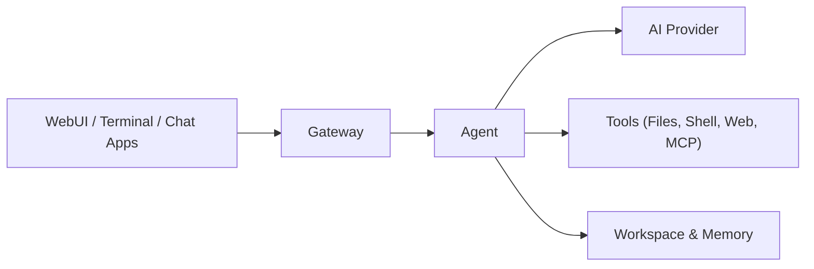

# Concepts

This page explains how nanobot's main pieces fit together in plain language, so you can configure models, workspaces, memory, and automations with confidence.

For source-code structure and contributor details, see [Architecture](./architecture.md).

## Main Building Blocks



| Part | What it does |
|---|---|
| Agent | Reads your message and conversation context, runs enabled tools when needed, and writes the reply |
| Providers | AI services or local servers (OpenRouter, Anthropic, OpenAI, Bedrock, Ollama, vLLM, and more) |
| Channels | Ways to talk to nanobot: WebUI, terminal (CLI/TUI), Telegram, Discord, Slack, Feishu, WeChat, Email, Mattermost, Linear, and others |
| Tools | Capabilities the agent can use, such as files, shell commands, web search, MCP servers, image generation, automations, and subagents |
| Memory | Saved conversation history and long-term workspace notes that carry context forward |
| Gateway | The background service that keeps the WebUI, chat apps, and automations running |

To send a single test message, run `nanobot agent -m "Hello!"`. For everyday use with the WebUI, chat apps, or scheduled tasks, nanobot runs the gateway in the background.

## Config vs Workspace

By default, everything lives under `~/.nanobot/`:

| Path | What it stores |
|---|---|
| `~/.nanobot/config.json` | Settings: providers, model presets, channels, tools, and security options |
| `~/.nanobot/workspace/` | Agent state: long-term memory, skills, `HEARTBEAT.md`, automations, and generated files |
| `~/.nanobot/sessions/` | Saved conversation history (stored separately from the workspace) |

The **config file** controls what nanobot is allowed to use. The **workspace** holds the agent's durable state. You can point commands at a different config or workspace with `--config` and `--workspace` (or `--home`; see [Multiple Instances](./multiple-instances.md)).

### Agent Workspace and Project Workspace

Your configured workspace is the **agent workspace**. In the WebUI, you can also pick a different **project workspace** (such as a code repository) for a specific topic without changing your agent's identity or memory:

| What | Comes from |
|---|---|
| Project instructions (`AGENTS.md`) | The selected project folder |
| Agent personality and user profile (`SOUL.md`, `USER.md`) | The agent workspace |
| Long-term memory and custom skills (`memory/`, `skills/`) | The agent workspace |
| Relative file paths and shell commands | The selected project folder |

When you do not pick a separate project, both roles use the same directory. Picking a project changes where the agent works for that topic; it does not create a separate agent or separate memory.

## Entry Points: CLI, WebUI, and Gateway

| Entry point | Command | Best for |
|---|---|---|
| One-shot CLI | `nanobot agent -m "..."` | Quick checks, scripts, and troubleshooting |
| Interactive CLI / TUI | `nanobot` (or `nanobot agent`) | Terminal chat with saved session history |
| WebUI | `nanobot webui` | Everyday browser workbench (starts the gateway automatically) |
| Gateway | `nanobot gateway` | Headless servers, chat apps, and background automations |

The WebUI runs on port `8765` by default (`http://127.0.0.1:8765`). The gateway health check runs on port `18790` (`http://127.0.0.1:18790/health`).

## Providers and Model Presets

Configure your providers and models in **Settings → Models**, then pick a preset from the chat composer.

A **model preset** pairs a provider with a model ID (and optional settings). Pinning the provider explicitly inside each preset is the easiest way to avoid setup mistakes. OAuth providers (such as OpenAI Codex, xAI Grok, and GitHub Copilot) require signing in first and selecting that provider in your preset.

<details>
<summary>Manual configuration example</summary>

```json
{
  "modelPresets": {
    "primary": {
      "provider": "openrouter",
      "model": "anthropic/claude-opus-4.5"
    }
  },
  "agents": {
    "defaults": {
      "modelPreset": "primary"
    }
  }
}
```

</details>

See [Providers and Models](./providers.md) and the [Provider Cookbook](./provider-cookbook.md) for provider-specific setup.

## Sessions, Memory, and Dream

nanobot separates short-term chat history from long-term memory:

- **Sessions** keep the messages of each conversation. By default, each WebUI topic and each chat-app thread has its own session.
- **Long-term memory** lives in your agent workspace (`SOUL.md`, `USER.md`, `memory/MEMORY.md`, and optional `memory/wiki/` pages).
- **Dream** is a periodic background job that reviews summarized conversations and updates your long-term memory so important preferences and facts carry across topics.

See [Memory](./memory.md) for how memory works and how to inspect or restore it.

## Apps, Plugins, and Skills

You can extend nanobot from the **Apps** and **Skills** pages in the WebUI:

| Concept | What it does |
|---|---|
| Agent Plugin | An installable package that bundles skills, MCP servers, or both |
| Skill | Reusable instructions loaded when relevant or invoked with `$skill-name` |
| MCP server | External tools exposed to the agent over Model Context Protocol |
| CLI App | A local command-line tool adapter managed from **Apps** |

See [WebUI Apps](./webui.md#apps) and [Skills](./webui.md#skills) to manage them.

## Tools and Safety

nanobot includes built-in tools for files, shell commands, web search/fetch, image generation, automations, and subagents, plus any tools added through **Apps**.

- In the WebUI, use **Restricted** mode to keep file and shell work inside the selected workspace.
- For chat apps, use pairing or `allowFrom` allowlists so only people you approve can talk to your bot.
- For tighter restrictions, sandboxing, and network rules, see [Configuration: Security](./configuration.md#security).

## Subagents

nanobot can delegate parts of a complex request to subagents while staying responsible for your final answer. Inside the same conversation, you can ask it to check progress, send follow-up instructions, wait for results, or cancel a specific subtask.

- Background subtasks report back to the conversation that started them.
- `/stop` stops the current session and its subagents without affecting other sessions (it does not undo file changes already made).
- Subagents belong to their parent conversation: deleting that conversation stops and removes them, and forking does not copy them.
- If the gateway restarts while a subtask is running, unfinished subtasks are marked interrupted with any partial results saved; ask nanobot to start a new task if you want to continue.
- Subagents are not available in WebUI temporary chats.

See [Delegated work](./webui.md#delegated-work) for viewing subtasks in the WebUI.

## Automations and Background Jobs

While the gateway is running, nanobot can act on its own in three ways:

- **Scheduled automations:** Tasks you ask nanobot to run at a specific time or on a schedule, replying back in the same chat.
- **Local triggers:** Created with `/trigger <name>` so a local script or webhook can wake nanobot in that chat with `nanobot trigger <id> "<message>"`.
- **Heartbeat:** A quiet periodic check driven by `<workspace>/HEARTBEAT.md` that only messages you when something needs attention.

See [Automations](./automations.md) for the full guide.

## Where to Go Next

| Need | Read |
|---|---|
| First working install | [Install and Quick Start](./quick-start.md) |
| Browser workbench | [WebUI](./webui.md) |
| Provider and model setup | [Providers and Models](./providers.md) |
| Chat app setup | [Chat Apps](./chat-apps.md) |
| Complete config reference | [Configuration](./configuration.md) |
| Runtime debugging | [Troubleshooting](./troubleshooting.md) |
